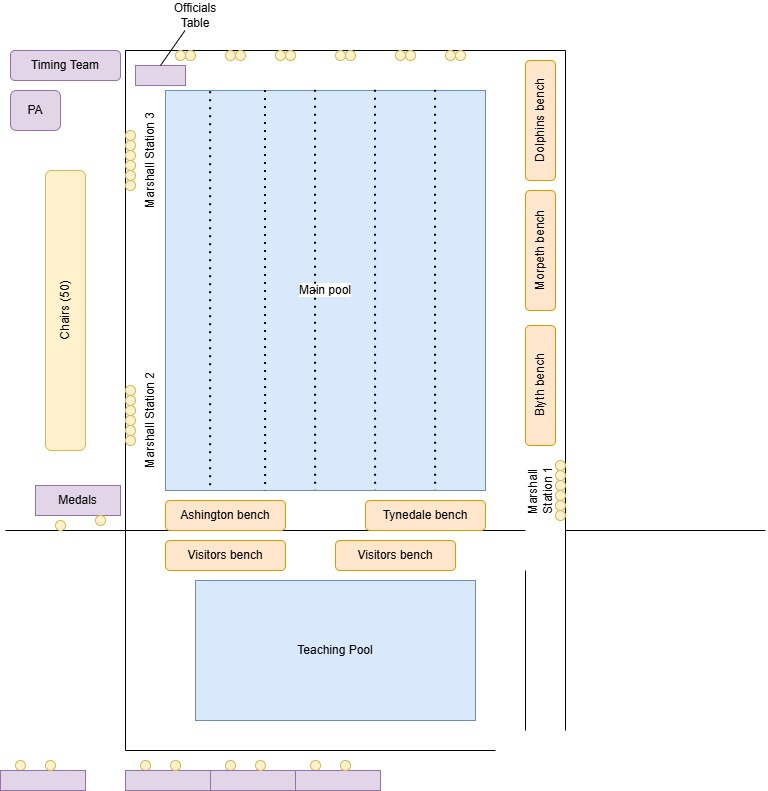
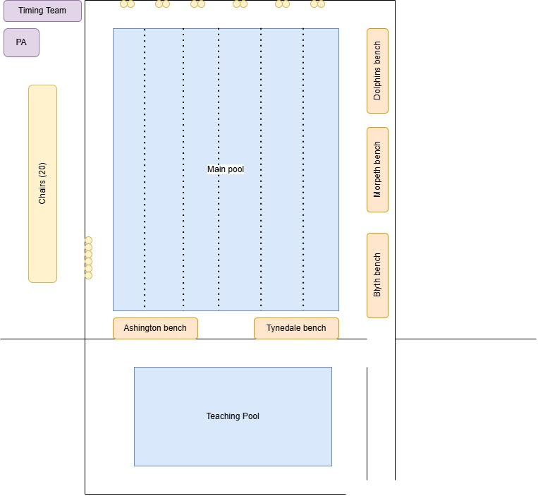
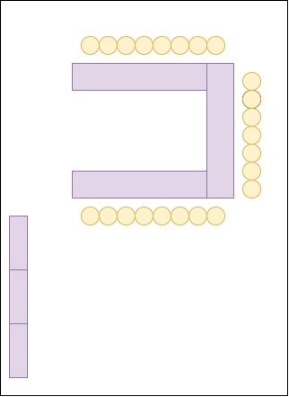

# Gala checklist

For every home gala, the [Lead Organiser](gala_roles.qmd) needs to ensure the 
following tasks are completed.
The person in the named role is responsible for ensuring the tasks assigned to 
that roll are completed.

```{r}
library(dplyr)
library(gt)

data <- read.csv("gala-checklist.csv", check.names = FALSE) |>
    select(Timing, Action, `Responsible Person`) |>
    gt() |>
    fmt_markdown(columns = `Responsible Person`) 
data 
```

The pool layout plan needs to be shared with Willowburn a week before the event.
For multi-session galas, the main plan is used, along with the studio layout plan.
For smaller half-day events the second plan is required.

## Plan for bigger invitationals



## Plan for single session events



## Studio layout


